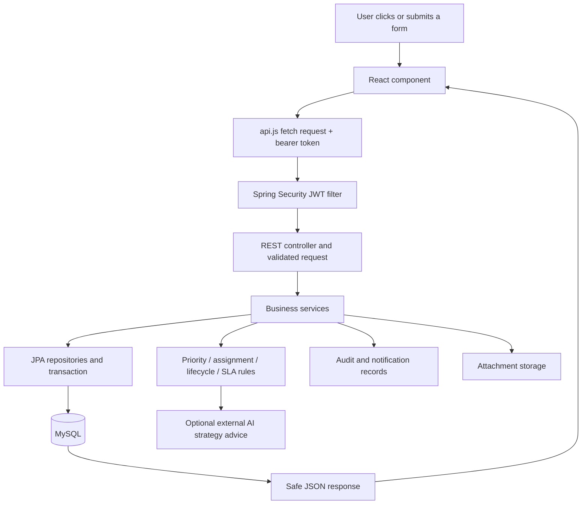
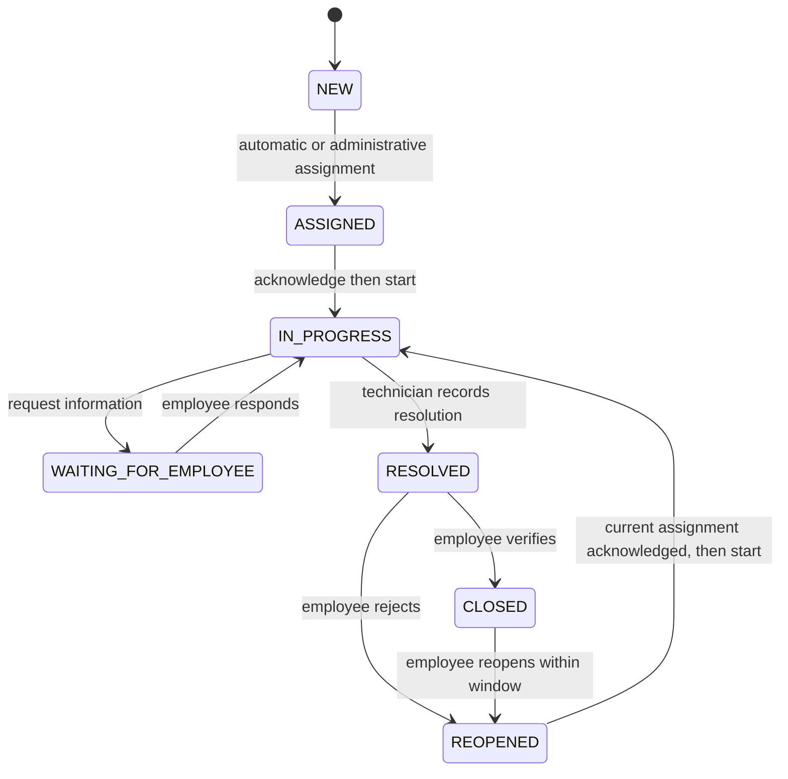

# I-ITSM — Complete Implementation and Learning Report

Prepared: 18 November 2026. Based on the source code, database migrations, configuration, and recorded verification evidence in this local project.

This is a guide to what the application does, why its pieces exist, and how to read the implementation. It describes the current implementation rather than a proposed design. Test results are identified by their evidence and date; writing this report did not rerun the full test suite or change application functionality.

## 1. What you have built

I-ITSM is an IT incident management application. An employee reports a problem, the application calculates its priority and routes it to a technician, the technician investigates and proposes a resolution, and the employee verifies whether the problem is fixed. Administrators manage the people, routing rules, service commitments, and reports.

An incident is a support record, such as “My VPN connection fails.” A service identifies the business service affected, such as Network & connectivity. A category classifies the problem, such as Access & identity. Priority expresses severity. An SLA, or service-level agreement, sets response and resolution time targets.

The application stores real records in MySQL. React displays those records and sends user actions to Java APIs. Java enforces permissions and business rules. It is a modular monolith: one deployable backend with separate packages for different responsibilities, rather than multiple independently deployed services.

### Technologies and their jobs

| Technology | Purpose in this project |
|---|---|
| Java 25 | Language and runtime for the backend |
| Spring Boot 4.1.2 | Starts the application, configures its web server and integrates its libraries |
| Spring MVC | Maps HTTP requests to controller methods |
| Spring Security | Authentication filtering and access protection |
| Bean Validation | Checks required fields, lengths, ranges and request constraints |
| Spring Data JPA / Hibernate | Maps Java entities to relational records and executes persistence operations |
| MySQL | Durable production database |
| Flyway | Applies versioned SQL schema migrations |
| Maven | Resolves backend dependencies, compiles, tests and packages Java |
| React 19.2 | Renders the browser interface from components and state |
| JavaScript / JSX | Implements frontend behavior and component markup |
| Vite 7.2.2 | Frontend development server and production asset builder |
| CSS | Layout, spacing, colors, responsive behavior and sidebar scrolling |
| Lucide React | Interface icons |
| Recharts | Charts for reports and dashboards |
| springdoc 3.2.0 | Generates OpenAPI documentation and Swagger UI |
| JUnit 5 / Mockito | Backend tests and controlled test collaborators |
| H2 | Fast test-only database; never the production database |
| Vitest / Testing Library / jsdom | Frontend component and API-helper tests |
| Python | Live HTTP demonstration script |

A dependency is a reusable library your project uses. Maven tracks Java dependencies in `backend/pom.xml`; npm tracks frontend dependencies in `frontend/package.json` and locks resolved versions in `package-lock.json`.

## 2. The complete user-facing feature set

### Employee workspace

Employees can register, verify their email, sign in, recover a password, and sign out. After authentication they can create incidents with a title, description, service, category, impact, urgency, criticality, affected-user count, and optional attachments.

They can search and filter their own incidents, view their histories, comment, provide requested information, download permitted attachments, verify or reject proposed resolutions, reopen eligible closed incidents, and leave a one-time rating and comment after closure. They receive private notifications and see reports scoped to their records.

### Technician workspace

Technicians see currently assigned incidents. They explicitly acknowledge an assignment, start investigation, add comments or internal investigation notes, request more information from the employee, and record a resolution. They can inspect their workload and recognized category skills.

Acknowledgement matters: automatic assignment alone does not count as responding to the employee. A new assignee must acknowledge their current assignment before starting or resolving work.

### Administrator workspace

Administrators can view all incidents, reassign technicians with a reason, override priorities with a reason, manage registered users' roles/activation/availability, manage services and categories, configure priority and routing rules, create versioned SLA policies, inspect SLA cycles and compliance, view reports, inspect audit history, and inspect email delivery outcomes.

An administrator cannot substitute for the employee's verification of a resolution. User management edits registered accounts; it is not an admin-created-account or verification-bypass feature.

### Interface screens

| Screen | What it contains |
|---|---|
| Authentication | Sign-in, registration, verification, resend verification, forgotten/reset password |
| Overview | Role-scoped metrics, charts and recent incidents |
| Incidents | Search, filters, sorting, paging and incident creation for employees |
| Incident detail | Facts, permitted next actions, resolution attempts, comments, history, SLA cycles, assignments, priorities and attachments |
| Notifications | Current user's notifications and read actions |
| Technicians | Workload, verified resolution count and recognized skills; technician self-view or administrator view |
| Users | Administrator role, activation and availability controls |
| Catalog | Service and category administration |
| SLA monitor | Clock status, timing, snapshots and historical signals |
| SLA policies | Service/priority targets and policy versions |
| Configuration | Priority calculation, assignment strategies, weights, skill threshold, warnings, reopening window and incident email setting |
| Reports | Status/priority/service/category summaries, trends and SLA compliance |
| Audit log | Historical business and administrative actions |
| Email delivery | Delivery statuses, attempts and failures |

The top-bar “Connected workspace” label is static interface text, not a continuous server-health monitor. The application does not implement WebSocket live updates; screens load data through HTTP requests and refresh following relevant interactions.

## 3. How the layers communicate



The frontend never connects directly to MySQL. A browser request goes to the backend, which checks it and returns only permitted information. This prevents someone from gaining access simply by changing the interface or manually calling an endpoint.

### Example: submitting a VPN incident

1. `CreateIncident` collects form values and converts numeric fields to numbers.
2. `api.js` sends a JSON request to `POST /api/incidents`, attaching the login token.
3. `JwtFilter` verifies the token and current account state.
4. `IncidentController` accepts an explicitly defined request object.
5. `IncidentService` checks employee permission and catalog validity, then orchestrates creation inside a transaction.
6. `PriorityEngine` calculates severity from the configured factors.
7. `SlaService` starts response and resolution clocks using the relevant active policy.
8. `AssignmentEngine` finds eligible technicians and chooses one using a validated strategy or fallback.
9. History, audit and in-app notification records are saved with the business change.
10. The API returns an incident detail projection and React displays it. Optional file uploads are separate requests, so incident creation and attachment upload are not one atomic HTTP operation.

A transaction is a group of database changes that either commits together or rolls back. This avoids partially created business state when a required operation fails.

## 4. Backend structure and Java concepts

The entry point is `Application.java`. Spring discovers annotated classes and supplies their collaborators through dependency injection. For example, `AssignmentEngine` receives a repository, an advisor, event handling, and a clock instead of constructing all those dependencies itself.

| Layer or concept | Meaning and implementation |
|---|---|
| Controller | HTTP boundary: route, request fields, validation and response status |
| Service | Business behavior, authorization checks and orchestration |
| Entity | Java representation of a persisted database record |
| Repository | Data-access abstraction: `Store` and `UserRepository` |
| DTO/projection | Explicit request/response shape; avoids exposing whole internal entities |
| Interface | Contract implemented by interchangeable providers or strategies |
| Transaction | Atomic database unit of work |
| Exception mapping | Converts failures into consistent HTTP responses |
| Scheduled worker | Background processing triggered at an interval |

`Store` wraps common EntityManager operations, including queries, paging and locks. `UserRepository` uses Spring Data for identity access. JPA is the persistence specification; Hibernate is the implementation doing the mapping. MySQL is the database itself. These three names describe different layers.

`Views` builds safe response objects. `Problem` represents business failures, and `Errors` maps failures to responses. Password hashes, private storage paths and account-token hashes are not ordinary response fields.

### Object-oriented design actually used

- **Abstraction:** `AssignmentStrategy`, `StrategyAdvisor` and `FileStorage` define contracts.
- **Polymorphism:** different assignment strategies implement the same selection contract.
- **Composition:** incident orchestration delegates to SLA, assignment, priority, events and skill services.
- **Encapsulation:** business changes go through service methods instead of arbitrary status-edit APIs.
- **Strategy pattern:** interchangeable priority algorithms and technician-selection strategies.
- **Factory/registry:** assignment names map to specific Java implementations.
- **State-machine approach:** `Lifecycle` centrally decides valid transitions.
- **Observer-style events:** business events generate notification handling.
- **Repository pattern:** services use data-access abstractions.

These are practical uses of OOP, not an artificial inheritance tree where unrelated entities share a superclass just to demonstrate inheritance.

## 5. Authentication, authorization and logout

Authentication answers “Who are you?” Authorization answers “Are you allowed to do this?” Both are necessary.

Passwords are stored as BCrypt hashes. A hash is a one-way representation used to check a password without storing its readable value. Login checks the password and account status, then issues a signed JWT lasting one hour. JWT signing proves integrity; it does not mean the token's contents are encrypted.

React keeps the token in memory. `api.js` adds `Authorization: Bearer <token>` to authenticated requests. The backend checks the signature, expiry, and current user state, including token version. Account changes and password recovery invalidate previous sessions through that version.

Sign-out clears the frontend token and current-user state. Refreshing the page also loses the in-memory session. There is no refresh-token flow or server-side logout deny-list. A separately copied valid JWT is not revoked merely by clicking sign-out; it expires or is invalidated by a relevant account/password change.

Registration always creates an employee, never a caller-selected administrator. Verification and recovery use random, expiring, single-use tokens whose hashes are stored in the database. Recovery responses are generic to avoid revealing whether an email exists.

### Permission boundaries

| Actor | Incident visibility | Special operations |
|---|---|---|
| Employee | Own reports | Respond, verify, reject, reopen, feedback |
| Technician | Current assignments | Acknowledge, investigate, request information, resolve |
| Administrator | All incidents | Reassign, override priority, configure and monitor |

Internal notes are removed from employee responses on the server. Attachments are checked against access to their parent incident. Notification read operations require ownership. Hiding a button is only a usability aid; server checks enforce security.

The security configuration uses stateless bearer-token authentication and an allowed-origin CORS configuration. CSRF protection is disabled for this design, which does not use an automatically attached login cookie. Moving authentication into cookies would require reviewing that decision. HTTPS, rate limiting, MFA and SSO are deployment/future concerns, not completed features here.

## 6. Incident lifecycle



`RESOLVED` means the technician has proposed a fix; `CLOSED` means the employee verified it. This separation is central to quality control.

Acknowledgement is recorded on assignment history without creating another lifecycle state. A newly assigned technician must acknowledge their own assignment. An incident can stay NEW when no eligible technician exists; administrators are notified.

Requesting information requires a question. Responding requires an answer. Resolution requires an explanation. Rejecting or reopening requires a reason. Arbitrary state updates are not exposed as an API.

The default reopening window is 90 days from the latest verified closure and is configurable. Rejection starts a new resolution cycle immediately. Each resolution attempt remains recorded, so a failed earlier fix is not overwritten.

## 7. Priority calculation

Priority is calculated by backend code, not by AI. There are two configurable algorithms.

### Formula algorithm

Default score:

`3 × impact + 3 × urgency + 2 × criticality + affected-user tier`

Impact, urgency and criticality are each 1–3. Affected-user tier is 1 for fewer than 10 people, 2 for 10–99, and 3 for 100 or more.

| Score | Priority |
|---|---|
| Below 13 | LOW |
| 13–19 | MEDIUM |
| 20–26 | HIGH |
| 27 or more | CRITICAL |

Example: impact 2, urgency 2, criticality 2, five affected users produces `6 + 6 + 4 + 1 = 17`, therefore MEDIUM. Administrators can change weights and cutoffs.

### Matrix algorithm

Impact selects a row and urgency selects a column in a configurable 3×3 matrix. Criticality 3 or at least 100 affected users raises the result by one level, capped at CRITICAL.

| Impact / urgency | 1 | 2 | 3 |
|---|---|---|---|
| 1 | LOW | LOW | MEDIUM |
| 2 | LOW | MEDIUM | HIGH |
| 3 | MEDIUM | HIGH | CRITICAL |

Every calculation or manual override records the factors, configuration version, actor and reason in priority history. A manual override can revise running SLA targets; it does not erase the original snapshot.

## 8. Assignment, AI and fallback

An eligible technician must have the TECHNICIAN role, an active and verified account, and availability enabled. Eligibility is enforced in Java regardless of AI advice.

| Strategy | Selection rule |
|---|---|
| LEAST_LOADED | Lowest active workload; recognized category skill breaks a workload tie; then technician ID |
| SKILL_FIRST | Recognized category skill first, then workload, then ID |
| ROUND_ROBIN | Oldest last-assignment history ID first; never-assigned technicians use 0; then ID |
| PRIORITY_WEIGHTED | Lowest `workload × loadWeight − skilled × skillWeight × (priorityRank + 1)`; then ID |

For the weighted formula, skilled is 1 or 0 and severity ranks run from LOW=0 to CRITICAL=3. Default load weight is 10 and skill weight is 100. Final ID tie-breaking makes results repeatable for identical inputs.

The AI adapter calls an OpenAI-compatible chat-completions endpoint. It sends structured priority/category/candidate information, excluding employee names, incident titles and descriptions. It asks for one enabled strategy identifier. The AI does not select an arbitrary technician, change permissions, generate resolutions, or control the database.

Java validates the returned identifier and executes the corresponding deterministic strategy. Missing credentials, network failure, timeout, non-200 response, invalid output or a disabled strategy cause LEAST_LOADED fallback. That fallback remains available even if every normal strategy is disabled. No candidate means no assignment, not a fabricated technician.

Assignment history records the selected strategy, source, reason, previous/current technician, timestamp and acknowledgement. There is a real HTTP adapter, but a live external-provider account has not been validated in the recorded implementation work. Controlled provider-response tests and live missing-key fallback are different kinds of evidence.

## 9. Workload and recognized skills

Workload is derived from current incident records whose technician matches and whose state is neither RESOLVED nor CLOSED. It is not a separately maintained counter.

| Event | Workload effect |
|---|---|
| Assign an active incident | New owner +1 |
| Acknowledge or start | No change |
| Wait for employee | No change |
| Resolve | Current owner −1 |
| Verify and close | No second decrement |
| Reopen | Active owner gains workload again |
| Reassign active work | Old owner −1; new owner +1 |
| Reassign resolved work | No active workload added |

This avoids drift from incrementing or decrementing a counter incorrectly. The current implementation queries matching incidents and obtains the count from the result; optimizing this to SQL COUNT would help larger installations.

A verified resolution earns a category skill credit for the technician who actually supplied the resolution. Rejected resolutions earn no credit. Credit is unique per incident, so repeated reopen/verify cycles cannot manufacture extra credits. The default recognition threshold is 60 verified incident credits in a category. The recognized skill stores its date and the threshold used. Lowering the threshold takes effect on a subsequent verified resolution, not as a retroactive bulk award.

## 10. SLA clocks, snapshots and revisions

The response clock measures time from incident creation to the first explicit assignment acknowledgement. The resolution clock measures active time from creation to resolution.

Both start at creation, so time waiting for assignment counts. Only the resolution clock pauses while waiting for employee information. Once the original response clock stops, reassignment and reopening do not restart it. Rejection or reopening creates another resolution cycle.

A snapshot preserves the rules that originally applied: policy identity/version, priority, original target and start time. These original snapshot fields are mapped as non-updatable JPA columns. A revision is a separate record explaining a later target/priority change. This protection is in the application persistence model, not a claim that a privileged database administrator cannot edit SQL records directly.

### Timing example

An incident starts at 09:00 with a two-hour resolution target. It waits for employee information from 09:30 to 10:00. At 10:30, 90 wall-clock minutes have passed, but only 60 active minutes count. Its adjusted deadline is 11:30.

If the administrator changes the priority, the running cycle may get a new target. Its original 09:00 start and recorded 30-minute pause are preserved. The application does not reset the clock to the time of the priority edit.

For an unpaused cycle:

`deadline = original start + current target + accumulated pauses`

During an ongoing pause, the projection also accounts for the time currently paused. Stopped cycles remain stable. Missing policy during a priority override retains the existing target and reports a configuration issue. Missing policy for initial creation or a new reopening cycle prevents that transaction.

The scheduler checks approximately every 15 seconds. Defaults warn at 50% and 80%; breach occurs when elapsed active time exceeds the target. Each cycle/threshold signal is unique, preventing duplicate warnings. Signal records distinguish the actual deadline from when the scheduler detected it. Previously recorded breaches remain historical facts even if targets later change.

SLA compliance is completed cycles without a historical breach divided by completed cycles. Running cycles are excluded from that denominator. Average resolution duration averages completed resolution cycles and excludes employee-wait time. These are cycle-based metrics, which is significant when an incident has been reopened.

## 11. Data integrity and concurrent requests

Two simultaneous requests could otherwise both see the same technician as least loaded. Routing-sensitive mutations acquire a pessimistic lock on the singleton settings record, and appropriate incident locks, within transactions. READ_COMMITTED isolation helps subsequent work see preceding committed assignments after acquiring the lock.

The database also has foreign keys, uniqueness constraints and indexes. Foreign keys prevent orphan references. Uniqueness prevents duplicate feedback, duplicate skill credit and repeated threshold signals. Indexes help common searches.

The implementation prioritizes correctness by serializing important mutations. The bounded AI request can occur while the lock is held, limiting throughput. This is a documented tradeoff, not proof of high-volume scalability or multi-node load-test coverage.

## 12. Database: all 21 application tables

| Table | Purpose |
|---|---|
| app_user | Identity, password hash, role, status, availability and token version |
| catalog_item | Typed SERVICE and CATEGORY records |
| settings | Central configurable rules, revision and serialization lock |
| incident | Current incident facts, state, priority, reporter and assignment |
| incident_comment | Comments, employee responses and flagged internal notes |
| resolution_record | Each proposed fix, technician, verification/rejection details |
| assignment_history | Ownership changes, strategy/source/reason and acknowledgement |
| priority_history | Previous/new priority, input factors and configuration version |
| sla_policy | Versioned response/resolution targets by service and priority |
| sla_cycle | Original response/resolution snapshot and timing state |
| sla_revision | Append-only target/priority revisions for a cycle |
| pause_record | Start/end of resolution waiting intervals |
| sla_signal | Warning/breach threshold, deadline and detection time |
| audit_log | Actor, operation, affected entity, details and time |
| notification | User notices, read state and incident-email delivery state |
| account_token | Hashed verification/recovery tokens, expiry and consumption |
| mail_job | Durable account-email delivery jobs and retry outcomes |
| attachment_metadata | File ownership, safe metadata, storage key and deletion flag |
| feedback | One rating/comment per incident |
| skill_credit | One verified incident credit attributed to a technician/category |
| technician_skill | Recognized skill and recognition history |

Flyway also maintains its own migration metadata, separate from these application tables.

`V1__initial.sql` creates the schema, relationships, indexes and initial settings. `V2__constraints.sql` adds further constraints/indexes. Hibernate validates the schema at startup rather than creating it. Use new migrations for future schema changes instead of editing already-applied migration history.

Files themselves are stored on disk, not as database blobs. Database backups alone therefore do not restore attachment bytes. Durable recovery requires the database and attachment directory, with configuration/credentials managed separately.

## 13. Comments, attachments, feedback, audits and notifications

Comments support discussion; internal notes support technician/admin investigation without exposing that content to employees. History records preserve earlier actions and resolution attempts.

Attachments support PDF, PNG, JPEG and text, up to 5 MB per file. Validation checks size, extension and content signatures. Filenames are sanitized and random UUID keys determine disk storage. Downloads recheck incident access and force download with protective response headers. Deletion is logical and restricted to an authorized uploader or administrator; bytes remain for retention/audit. Malware scanning and automated retention cleanup are not implemented.

Feedback is a 1–5 rating with an optional comment, accepted from the reporter only after closure and only once per incident.

Audit records are append-only through the application and have no update/delete API. They capture administrative and business changes. This is not a cryptographic tamper-proof audit system against privileged database access.

In-app notifications are persisted within business transactions. Email delivery happens later so an SMTP outage does not undo an incident update. Account mail uses a durable outbox; incident notifications also retain delivery outcomes. Delivery runs every 30 seconds with at most three automatic attempts. Administrators see outcomes/errors without seeing token-bearing mail bodies; delivered account-mail bodies are scrubbed.

Without SMTP, seeded verified users can use the application, but newly registered users cannot complete the normal email-verification journey. Real mailbox delivery has not been demonstrated with live provider credentials.

## 14. Search, reporting and API behavior

Search supports text, status, priority, service, category, reporter, technician, date range and SLA status. User scope is enforced independently of requested filters. Paging defaults to 20 and is bounded to 100 records; sorting uses an allow-list. Priority sorting uses stored priority text, not semantic severity order.

Reports include total/active/resolved counts, historical breached cycles, SLA compliance, average resolution seconds, average feedback, breakdowns by status/priority/category/service, and UTC daily trends. Technicians have workload and skill projections. Empty averages/compliance can be null rather than misleading zeroes.

Report aggregation currently runs in Java. Large datasets would benefit from SQL aggregation and more history pagination. Frontend timestamps use local time; trend day buckets use UTC.

### API map

All routes below start with `/api`.

| Area | Main routes |
|---|---|
| Accounts | `/auth/register`, `/auth/login`, `/auth/me`, `/auth/verify`, `/auth/resend-verification`, `/auth/forgot-password`, `/auth/reset-password` |
| Catalog | `/catalog`, `/admin/catalog`, `/admin/catalog/{id}` |
| Administration | `/admin/users`, `/admin/users/{id}`, `/admin/settings`, `/admin/sla-policies` |
| Incidents | `/incidents`, `/incidents/{id}` |
| Workflow | `/incidents/{id}/actions`, `/comments`, `/reassign`, `/priority`, `/feedback` under the incident route |
| Files | `/incidents/{id}/attachments`, `/attachments/{id}` |
| Monitoring | `/admin/sla`, `/admin/sla-compliance`, `/reports`, `/technicians` |
| Notifications | `/notifications`, `/notifications/{id}/read`, `/admin/delivery` |
| Audit | `/admin/audit` |

GET reads; POST creates or performs an action; PUT updates configuration; DELETE logically deletes attachments. JSON is the normal format; uploads use multipart FormData. The API returns safe objects, arrays, paginated responses or messages.

Errors generally contain a `message`: 400 invalid request, 401 missing/invalid authentication, 403 forbidden, 404 missing resource, 409 conflict, 413 oversized upload, 422 invalid business operation, and 500 unexpected internal failure. See `docs/api.md` for every method, DTO, field and access rule; `docs/openapi.json` is the captured machine-readable contract.

## 15. Frontend implementation explained

React components are functions that describe the interface. JSX is JavaScript syntax for that description. State stores changing values such as the selected incident; props pass values and callbacks between components. Effects load data when relevant state changes.

The app uses React's built-in state/effect hooks and conditional rendering. It does not have a separate Redux store or a React Router page-routing setup. Navigation is mainly the selected-page state in `main.jsx`; selecting an incident sets its ID and renders its detail component. Browser refresh does not preserve the logged-in workspace or selected page.

| File | Responsibility and what to study |
|---|---|
| main.jsx | Mounts React, tracks login/page/selection, constructs role navigation, shows toasts, manages mobile menu and logout |
| Auth.jsx | Authentication modes, form submission, session setup and errors |
| Dashboard.jsx | Loads report/recent-incident data and renders overview metrics |
| Incidents.jsx | Search/filter/paging list, incident creation and optional follow-up attachment upload |
| IncidentDetail.jsx | Loads detail/files, renders permitted actions and history tabs, sends mutations |
| Admin.jsx | Admin and shared supporting screens, configuration forms, users, policies, notifications, skills and reports |
| components.jsx | Shared badges, fields, tables, modal, pager, loading and empty states |
| api.js | Shared fetch wrapper, bearer-token memory, error handling, downloads and display helpers |
| style.css | Visual design and responsive layouts |
| app.test.jsx | Eight focused component/helper tests |
| vite.config.js | React plugin, dev API proxy, chart bundle split and jsdom test environment |
| index.html | HTML entry that loads the React application |

The API helper checks `response.ok`, surfaces server messages, handles 204 empty responses and distinguishes JSON from FormData. File downloads use a browser Blob/object URL and revoke that URL afterward.

Forms perform user-facing validation, but the server repeats validation because browser requests can be modified. Loading, empty and error states make the request lifecycle visible. Recharts is split into a separate production chunk; chunk separation does not by itself imply every chart is lazy-loaded.

Responsive CSS adapts cards, tables and navigation to smaller screens. The 18 November sidebar fix adds vertical overflow and prevents direct sidebar children shrinking, allowing the sign-out control to be reached when the long admin menu exceeds viewport height. Its production assets and JAR were rebuilt and its eight frontend tests passed. A browser-tool timeout prevented a fresh visual verification of that specific fix; it requires loading the rebuilt application to take effect.

## 16. Configuration, seed data and packaging

`.env.example` documents local settings; `.env` holds actual local values and must remain private. Important categories are DB connection, JWT signing secret, app port/origin, file storage, SMTP, external AI and optional development seeding. Frontend `VITE_*` values are embedded in browser assets and must never contain private keys.

`DemoSeed` runs only when enabled and the user table is empty. It creates one administrator, two technicians, two employees, three services, four categories, and SLA policies for each service/priority. Passwords come from configuration and are hashed. Changing the configured demo password later does not reset existing accounts.

| Seed priority | Response | Resolution |
|---|---|---|
| LOW | 4 hours | 48 hours |
| MEDIUM | 2 hours | 24 hours |
| HIGH | 30 minutes | 4 hours |
| CRITICAL | 15 minutes | 1 hour |

These are initial demonstration values; policy administration changes future policy selection.

### Development versus packaged execution

During development, Vite normally serves the frontend on 5173 and proxies `/api` to backend port 8080. If the backend uses 8081, the development proxy must match it. The prepared integrated application uses 8081, whereas portable configuration defaults to 8080.

During packaging, Vite produces `frontend/dist`. Maven copies those files into Spring Boot static resources and builds the executable JAR. One Java process then serves both UI and API. Building Maven without first rebuilding React can package stale frontend assets.

| Script | Purpose |
|---|---|
| scripts/build.sh | npm clean install, frontend tests/build, then Maven clean package |
| scripts/run-backend.sh | Development backend launch |
| scripts/run-packaged.sh | Loads local environment and launches existing JAR |
| scripts/test-mysql.sh | Runs backend tests against configured MySQL test schema |
| scripts/e2e.py | Executes real HTTP demonstration workflows and saves results |
| scripts/start-workspace-mysql.sh | Starts this workspace's isolated MySQL; depends on local downloaded tools and is not a portable installer |

### Run the prepared Mac project

Project root:

`/Users/sarthak.saxena1012gmail.com/Documents/Codex/2026-11-10/files-pasted-by-the-user-master/outputs/i-itsm`

If the workspace database is not already running, use a separate Terminal:

```sh
cd "/Users/sarthak.saxena1012gmail.com/Documents/Codex/2026-11-10/files-pasted-by-the-user-master/outputs/i-itsm"
./scripts/start-workspace-mysql.sh
```

In the application Terminal:

```sh
cd "/Users/sarthak.saxena1012gmail.com/Documents/Codex/2026-11-10/files-pasted-by-the-user-master/outputs/i-itsm"
./scripts/run-packaged.sh
```

Open http://localhost:8081. Do not start duplicate servers on an occupied port. Existing generated demo access information is in private `LOCAL-ACCESS.md`; no passwords are included in this report.

For a portable machine setup with Java 25, Maven, Node and MySQL installed, follow README.md, create your own database/user and `.env`, then run `./scripts/build.sh` and `./scripts/run-packaged.sh`. This workspace also contains a separate publishing copy, `outputs/i-itsm-github-ready`; do not assume it automatically contains subsequent fixes made to the working project.

## 17. Verification evidence and its limits

| Evidence | Recorded outcome |
|---|---|
| 10 November backend clean build | Maven clean package succeeded |
| MySQL backend suite | 67 passed; 0 failures/errors/skipped |
| H2 backend suite | Same 67 passed; test-only alternative database |
| Frontend suite | Eight passed historically and rerun successfully for the 18 November sidebar fix |
| Frontend build | Production Vite build succeeded, including latest sidebar fix |
| Latest sidebar package | Maven package with tests skipped succeeded; updated CSS bytes verified inside JAR |
| Saved live HTTP results | File timestamp 18 November 2026, 06:32:20 UTC; three main workflows plus administrator/access checks all PASS |
| Historical packaged browser check | Desktop 1440×1000 and mobile 390×844 checked on 10 November |
| Historical diagram checks | Seven existing technical-design Mermaid diagrams parsed |
| External AI / SMTP deployment | Live provider credentials and real mailbox delivery not validated |

There are 75 distinct automated cases: 67 backend plus eight frontend. Running the same backend suite on two databases does not create 134 distinct tests. A test named “creation sends numeric incident factors to actual API” uses mocked fetch in its implementation; it checks the outgoing request, not a live server. The Python demonstrations supply live HTTP evidence separately.

Backend tests cover lifecycle rules, formula/matrix priority, strategy ordering, invalid AI choices and fallback, workload, response/resolution clocks, pause/revision preservation, snapshot immutability after persistence, skill-credit deduplication, feedback constraints, access denial, internal notes, uploads, authentication and recovery. A controlled HTTP provider test checks the external adapter's request/response behavior.

Eight frontend tests cover successful login, failed login feedback, registration fields/password minimum, numeric incident submission, role-based creation visibility, bearer token/error propagation, lifecycle badges and duration/label helpers. They do not exhaustively test all frontend pages, visual sizes or keyboard accessibility.

The live workflows cover resolution with waiting/resume/verification/feedback, reopening with preserved historical clocks, scheduled warning/breach behavior, and administrator/access assertions. These demonstrations create persistent labeled development records; they are not read-only checks.

This report inventories the implementation and existing evidence. It is not a claim of a new full regression, accessibility, penetration, browser-compatibility or load test.

## 18. Known limitations and remaining work

1. Configure and validate a real external AI account if external advice is desired. Fallback already works without one.
2. Configure and verify real SMTP delivery for registration/recovery. There is no admin retry button after automated attempts are exhausted.
3. Add attachment malware scanning, physical retention cleanup and optional object storage for deployment needs.
4. Improve throughput by shortening lock-held work and revisiting advice/assignment sequencing with revalidation.
5. Replace large in-memory report aggregation with SQL aggregation and paginate growing histories.
6. Add deployment requirements such as HTTPS configuration, operational monitoring, tested backups, rate limiting, SSO/MFA as appropriate.
7. Sessions expire in one hour; no refresh token or logout revocation list exists.
8. Navigation is state-based, with no implemented persistent deep-link workspace routing.
9. There is no push-update transport or actual continuously checked connectivity indicator.
10. Current SLA time is 24/7 elapsed time, not business-hours/holiday calendars.
11. The recent sidebar fix still needs visual confirmation in the running rebuilt application after the browser-tool timeout.
12. Historical tests passing does not establish every possible browser, concurrency or deployment scenario is correct.

There is no dedicated problem-management, change-management, asset/CMDB, knowledge-base, chatbot, mobile-native app, cloud deployment or CI/CD pipeline claimed by this implementation. Its implemented domain is incident/service operations with the features described above.

## 19. How to learn this code in a useful order

**First pass — use the application.** Log in as employee, submit one incident, then use the assigned technician account to acknowledge/start/resolve it. Return as employee to verify. Observe how one action changes both UI and stored history.

**Second pass — follow the frontend.** Read `main.jsx`, `Auth.jsx`, then `api.js`. In browser developer tools, inspect a login or incident request: URL, method, status, JSON and the Authorization header. Keep tokens private. Read `Incidents.jsx` alongside what you see on screen.

**Third pass — trace one backend request.** Follow `IncidentController` into `IncidentService`, `PriorityEngine`, `AssignmentEngine` and `SlaService`. Identify the inputs, checks, database writes and returned projections. Read `Lifecycle` to understand why actions fail from the wrong state.

**Fourth pass — learn persistence.** Compare the `Incident` entity to the `incident` SQL table. Trace one incident's assignment and SLA records using its numeric ID. Learn primary keys, foreign keys and indexes using those real relationships.

**Fifth pass — study correctness.** Read the workflow tests for acknowledgement, pause/resume, priority revision and reopening. Predict expected behavior before reading each assertion. These explain the difficult business rules more clearly than memorizing annotations.

**Sixth pass — change one safe development setting.** Compare formula and matrix priority or two assignment strategies on labeled development data. Observe history and workload. Avoid altering real records just to experiment.

### Questions you should be able to answer

- Why must both React and Java validate a request?
- Why is resolving an incident different from closing it?
- Why does acknowledgement stop response time but not resolution time?
- What happens if the AI request fails or returns a disabled strategy?
- Why should changing today's policy not rewrite last month's SLA history?
- Why is workload derived from current incidents rather than a mutable counter?
- Why do file bytes need a backup in addition to MySQL?
- Why does hiding an admin button not secure an admin endpoint?
- Why do unit tests with mocks and live API demonstrations prove different things?
- Why does packaging require the frontend build before Maven packaging?

## 20. Glossary

| Term | Meaning |
|---|---|
| API | Contract through which one program asks another to perform operations |
| REST | Resource-oriented HTTP API style used here |
| Endpoint | Specific API path and method |
| JSON | Structured text format for request/response data |
| JWT | Signed token carried with authenticated requests |
| RBAC | Role-based access control |
| DTO | Deliberately shaped input/output object |
| ORM | Mapping between objects and relational tables |
| Migration | Versioned database schema change |
| Transaction | All-or-nothing database operation group |
| Pessimistic lock | Database lock that makes competing operations wait |
| Idempotence | Repetition does not create an additional unintended effect |
| Snapshot | Preserved original values at a point in time |
| Revision | Separate recorded change to an existing rule/target |
| Outbox | Persisted work waiting for later external delivery |
| Mock | Controlled test replacement for a collaborator |
| Integration test | Test that exercises several real components together |
| End-to-end workflow | A sequence traversing application boundaries, here through live HTTP and MySQL |
| JAR | Packaged Java application/archive |
| Bundle | Built browser JavaScript/CSS assets |
| Same origin | Frontend and API share scheme, hostname and port |

## 21. Existing documentation to read alongside this report

- `README.md`: setup, builds, environment, development and packaging.
- `docs/technical-design.md`: architecture, use cases, class design, ER model, state, assignment and sequence diagrams.
- `docs/api.md`: complete endpoint reference with methods, fields and permission rules.
- `docs/openapi.json`: captured API specification.
- `docs/test-results.md`: detailed historical test results and named cases.
- `docs/test-evidence/`: saved backend/frontend/package/browser/database/diagram checks.
- `docs/e2e-results.json`: latest saved live demonstration outcomes.
- `docs/demonstrations.md`: demonstration steps.
- `docs/limitations.md`: implementation limitations and future improvements.
- `IMPLEMENTATION.md`: implementation checklist.

## 22. Complete backend source map

Every production Java source file is listed below. Click a filename to inspect it in this local workspace.

| Source file | Responsibility |
|---|---|
| [Application.java](/Users/sarthak.saxena1012gmail.com/Documents/Codex/2026-11-10/files-pasted-by-the-user-master/outputs/i-itsm/backend/src/main/java/com/iitsm/Application.java) | Spring Boot entry point. |
| [assignment/AssignmentEngine.java](/Users/sarthak.saxena1012gmail.com/Documents/Codex/2026-11-10/files-pasted-by-the-user-master/outputs/i-itsm/backend/src/main/java/com/iitsm/assignment/AssignmentEngine.java) | Eligibility, workload, AI/fallback selection and assignment history orchestration. |
| [assignment/AssignmentHistory.java](/Users/sarthak.saxena1012gmail.com/Documents/Codex/2026-11-10/files-pasted-by-the-user-master/outputs/i-itsm/backend/src/main/java/com/iitsm/assignment/AssignmentHistory.java) | Persistent ownership/strategy/acknowledgement history. |
| [assignment/AssignmentStrategy.java](/Users/sarthak.saxena1012gmail.com/Documents/Codex/2026-11-10/files-pasted-by-the-user-master/outputs/i-itsm/backend/src/main/java/com/iitsm/assignment/AssignmentStrategy.java) | Common candidate/ranking contract. |
| [assignment/ExternalLlmAdvisor.java](/Users/sarthak.saxena1012gmail.com/Documents/Codex/2026-11-10/files-pasted-by-the-user-master/outputs/i-itsm/backend/src/main/java/com/iitsm/assignment/ExternalLlmAdvisor.java) | Real HTTP adapter for external strategy advice. |
| [assignment/LeastLoaded.java](/Users/sarthak.saxena1012gmail.com/Documents/Codex/2026-11-10/files-pasted-by-the-user-master/outputs/i-itsm/backend/src/main/java/com/iitsm/assignment/LeastLoaded.java) | Workload-first ranking. |
| [assignment/PriorityWeighted.java](/Users/sarthak.saxena1012gmail.com/Documents/Codex/2026-11-10/files-pasted-by-the-user-master/outputs/i-itsm/backend/src/main/java/com/iitsm/assignment/PriorityWeighted.java) | Configurable severity-aware weighted ranking. |
| [assignment/RoundRobin.java](/Users/sarthak.saxena1012gmail.com/Documents/Codex/2026-11-10/files-pasted-by-the-user-master/outputs/i-itsm/backend/src/main/java/com/iitsm/assignment/RoundRobin.java) | Oldest-assignment-first ranking. |
| [assignment/SkillFirst.java](/Users/sarthak.saxena1012gmail.com/Documents/Codex/2026-11-10/files-pasted-by-the-user-master/outputs/i-itsm/backend/src/main/java/com/iitsm/assignment/SkillFirst.java) | Recognized-skill-first ranking. |
| [assignment/StrategyAdvisor.java](/Users/sarthak.saxena1012gmail.com/Documents/Codex/2026-11-10/files-pasted-by-the-user-master/outputs/i-itsm/backend/src/main/java/com/iitsm/assignment/StrategyAdvisor.java) | Replaceable advice-provider contract. |
| [attachment/Attachment.java](/Users/sarthak.saxena1012gmail.com/Documents/Codex/2026-11-10/files-pasted-by-the-user-master/outputs/i-itsm/backend/src/main/java/com/iitsm/attachment/Attachment.java) | Persistent file metadata. |
| [attachment/AttachmentController.java](/Users/sarthak.saxena1012gmail.com/Documents/Codex/2026-11-10/files-pasted-by-the-user-master/outputs/i-itsm/backend/src/main/java/com/iitsm/attachment/AttachmentController.java) | Upload, list, download and deletion routes. |
| [attachment/AttachmentService.java](/Users/sarthak.saxena1012gmail.com/Documents/Codex/2026-11-10/files-pasted-by-the-user-master/outputs/i-itsm/backend/src/main/java/com/iitsm/attachment/AttachmentService.java) | Validation, authorization, metadata and storage coordination. |
| [attachment/FileStorage.java](/Users/sarthak.saxena1012gmail.com/Documents/Codex/2026-11-10/files-pasted-by-the-user-master/outputs/i-itsm/backend/src/main/java/com/iitsm/attachment/FileStorage.java) | Storage-provider interface. |
| [attachment/LocalFileStorage.java](/Users/sarthak.saxena1012gmail.com/Documents/Codex/2026-11-10/files-pasted-by-the-user-master/outputs/i-itsm/backend/src/main/java/com/iitsm/attachment/LocalFileStorage.java) | Filesystem byte storage using safe keys. |
| [audit/AuditLog.java](/Users/sarthak.saxena1012gmail.com/Documents/Codex/2026-11-10/files-pasted-by-the-user-master/outputs/i-itsm/backend/src/main/java/com/iitsm/audit/AuditLog.java) | Append-only application audit entity. |
| [audit/Events.java](/Users/sarthak.saxena1012gmail.com/Documents/Codex/2026-11-10/files-pasted-by-the-user-master/outputs/i-itsm/backend/src/main/java/com/iitsm/audit/Events.java) | Records audits and publishes/generates business notices. |
| [auth/Access.java](/Users/sarthak.saxena1012gmail.com/Documents/Codex/2026-11-10/files-pasted-by-the-user-master/outputs/i-itsm/backend/src/main/java/com/iitsm/auth/Access.java) | Role and object-level access guards. |
| [auth/AccountToken.java](/Users/sarthak.saxena1012gmail.com/Documents/Codex/2026-11-10/files-pasted-by-the-user-master/outputs/i-itsm/backend/src/main/java/com/iitsm/auth/AccountToken.java) | Persistent single-use verification/recovery token metadata. |
| [auth/AuthController.java](/Users/sarthak.saxena1012gmail.com/Documents/Codex/2026-11-10/files-pasted-by-the-user-master/outputs/i-itsm/backend/src/main/java/com/iitsm/auth/AuthController.java) | Authentication HTTP routes and request definitions. |
| [auth/AuthService.java](/Users/sarthak.saxena1012gmail.com/Documents/Codex/2026-11-10/files-pasted-by-the-user-master/outputs/i-itsm/backend/src/main/java/com/iitsm/auth/AuthService.java) | Registration, login, verification and password recovery logic. |
| [auth/JwtFilter.java](/Users/sarthak.saxena1012gmail.com/Documents/Codex/2026-11-10/files-pasted-by-the-user-master/outputs/i-itsm/backend/src/main/java/com/iitsm/auth/JwtFilter.java) | Reads bearer tokens and checks the current account. |
| [auth/JwtTokens.java](/Users/sarthak.saxena1012gmail.com/Documents/Codex/2026-11-10/files-pasted-by-the-user-master/outputs/i-itsm/backend/src/main/java/com/iitsm/auth/JwtTokens.java) | Issues and validates signed JWTs. |
| [auth/SecurityConfig.java](/Users/sarthak.saxena1012gmail.com/Documents/Codex/2026-11-10/files-pasted-by-the-user-master/outputs/i-itsm/backend/src/main/java/com/iitsm/auth/SecurityConfig.java) | Security filter chain, CORS, password encoder and UTC clock. |
| [category/CatalogItem.java](/Users/sarthak.saxena1012gmail.com/Documents/Codex/2026-11-10/files-pasted-by-the-user-master/outputs/i-itsm/backend/src/main/java/com/iitsm/category/CatalogItem.java) | Typed service/category entity. |
| [common/Errors.java](/Users/sarthak.saxena1012gmail.com/Documents/Codex/2026-11-10/files-pasted-by-the-user-master/outputs/i-itsm/backend/src/main/java/com/iitsm/common/Errors.java) | Central HTTP error mapping. |
| [common/Problem.java](/Users/sarthak.saxena1012gmail.com/Documents/Codex/2026-11-10/files-pasted-by-the-user-master/outputs/i-itsm/backend/src/main/java/com/iitsm/common/Problem.java) | Business exception and requirement checks. |
| [common/Store.java](/Users/sarthak.saxena1012gmail.com/Documents/Codex/2026-11-10/files-pasted-by-the-user-master/outputs/i-itsm/backend/src/main/java/com/iitsm/common/Store.java) | Generic JPA persistence/query/locking abstraction. |
| [common/Views.java](/Users/sarthak.saxena1012gmail.com/Documents/Codex/2026-11-10/files-pasted-by-the-user-master/outputs/i-itsm/backend/src/main/java/com/iitsm/common/Views.java) | Safe response projections. |
| [config/AdminController.java](/Users/sarthak.saxena1012gmail.com/Documents/Codex/2026-11-10/files-pasted-by-the-user-master/outputs/i-itsm/backend/src/main/java/com/iitsm/config/AdminController.java) | Administrative HTTP routes and validated DTOs. |
| [config/AdminService.java](/Users/sarthak.saxena1012gmail.com/Documents/Codex/2026-11-10/files-pasted-by-the-user-master/outputs/i-itsm/backend/src/main/java/com/iitsm/config/AdminService.java) | User/catalog/settings/policy management rules. |
| [config/DemoSeed.java](/Users/sarthak.saxena1012gmail.com/Documents/Codex/2026-11-10/files-pasted-by-the-user-master/outputs/i-itsm/backend/src/main/java/com/iitsm/config/DemoSeed.java) | Optional first-run development accounts, catalog and policies. |
| [config/OpenApiConfig.java](/Users/sarthak.saxena1012gmail.com/Documents/Codex/2026-11-10/files-pasted-by-the-user-master/outputs/i-itsm/backend/src/main/java/com/iitsm/config/OpenApiConfig.java) | API documentation configuration. |
| [config/SchedulingConfig.java](/Users/sarthak.saxena1012gmail.com/Documents/Codex/2026-11-10/files-pasted-by-the-user-master/outputs/i-itsm/backend/src/main/java/com/iitsm/config/SchedulingConfig.java) | Background schedule configuration. |
| [config/Settings.java](/Users/sarthak.saxena1012gmail.com/Documents/Codex/2026-11-10/files-pasted-by-the-user-master/outputs/i-itsm/backend/src/main/java/com/iitsm/config/Settings.java) | Versioned singleton business configuration. |
| [feedback/Feedback.java](/Users/sarthak.saxena1012gmail.com/Documents/Codex/2026-11-10/files-pasted-by-the-user-master/outputs/i-itsm/backend/src/main/java/com/iitsm/feedback/Feedback.java) | Persistent closure feedback. |
| [incident/Comment.java](/Users/sarthak.saxena1012gmail.com/Documents/Codex/2026-11-10/files-pasted-by-the-user-master/outputs/i-itsm/backend/src/main/java/com/iitsm/incident/Comment.java) | Incident discussion/internal note entity. |
| [incident/Incident.java](/Users/sarthak.saxena1012gmail.com/Documents/Codex/2026-11-10/files-pasted-by-the-user-master/outputs/i-itsm/backend/src/main/java/com/iitsm/incident/Incident.java) | Current incident state and facts. |
| [incident/IncidentController.java](/Users/sarthak.saxena1012gmail.com/Documents/Codex/2026-11-10/files-pasted-by-the-user-master/outputs/i-itsm/backend/src/main/java/com/iitsm/incident/IncidentController.java) | Incident search/create/detail/action routes. |
| [incident/IncidentService.java](/Users/sarthak.saxena1012gmail.com/Documents/Codex/2026-11-10/files-pasted-by-the-user-master/outputs/i-itsm/backend/src/main/java/com/iitsm/incident/IncidentService.java) | Transactional incident workflow orchestration. |
| [incident/Lifecycle.java](/Users/sarthak.saxena1012gmail.com/Documents/Codex/2026-11-10/files-pasted-by-the-user-master/outputs/i-itsm/backend/src/main/java/com/iitsm/incident/Lifecycle.java) | Allowed lifecycle transitions. |
| [incident/Resolution.java](/Users/sarthak.saxena1012gmail.com/Documents/Codex/2026-11-10/files-pasted-by-the-user-master/outputs/i-itsm/backend/src/main/java/com/iitsm/incident/Resolution.java) | Persistent resolution attempt and verification/rejection details. |
| [notification/MailJob.java](/Users/sarthak.saxena1012gmail.com/Documents/Codex/2026-11-10/files-pasted-by-the-user-master/outputs/i-itsm/backend/src/main/java/com/iitsm/notification/MailJob.java) | Durable account-email job. |
| [notification/Notification.java](/Users/sarthak.saxena1012gmail.com/Documents/Codex/2026-11-10/files-pasted-by-the-user-master/outputs/i-itsm/backend/src/main/java/com/iitsm/notification/Notification.java) | Persistent user notice and delivery status. |
| [notification/NotificationService.java](/Users/sarthak.saxena1012gmail.com/Documents/Codex/2026-11-10/files-pasted-by-the-user-master/outputs/i-itsm/backend/src/main/java/com/iitsm/notification/NotificationService.java) | Notice persistence and scheduled mail delivery. |
| [priority/PriorityEngine.java](/Users/sarthak.saxena1012gmail.com/Documents/Codex/2026-11-10/files-pasted-by-the-user-master/outputs/i-itsm/backend/src/main/java/com/iitsm/priority/PriorityEngine.java) | Formula/matrix priority calculation. |
| [priority/PriorityHistory.java](/Users/sarthak.saxena1012gmail.com/Documents/Codex/2026-11-10/files-pasted-by-the-user-master/outputs/i-itsm/backend/src/main/java/com/iitsm/priority/PriorityHistory.java) | Persistent priority factors and changes. |
| [report/QueryController.java](/Users/sarthak.saxena1012gmail.com/Documents/Codex/2026-11-10/files-pasted-by-the-user-master/outputs/i-itsm/backend/src/main/java/com/iitsm/report/QueryController.java) | Read endpoints for reports, notifications, technicians and monitoring. |
| [report/ReportService.java](/Users/sarthak.saxena1012gmail.com/Documents/Codex/2026-11-10/files-pasted-by-the-user-master/outputs/i-itsm/backend/src/main/java/com/iitsm/report/ReportService.java) | Role-scoped report aggregation. |
| [search/SearchService.java](/Users/sarthak.saxena1012gmail.com/Documents/Codex/2026-11-10/files-pasted-by-the-user-master/outputs/i-itsm/backend/src/main/java/com/iitsm/search/SearchService.java) | Scoped filters, sorting and pagination. |
| [sla/PauseRecord.java](/Users/sarthak.saxena1012gmail.com/Documents/Codex/2026-11-10/files-pasted-by-the-user-master/outputs/i-itsm/backend/src/main/java/com/iitsm/sla/PauseRecord.java) | Resolution waiting interval. |
| [sla/SlaCycle.java](/Users/sarthak.saxena1012gmail.com/Documents/Codex/2026-11-10/files-pasted-by-the-user-master/outputs/i-itsm/backend/src/main/java/com/iitsm/sla/SlaCycle.java) | Original SLA snapshot and running/stopped clock state. |
| [sla/SlaPolicy.java](/Users/sarthak.saxena1012gmail.com/Documents/Codex/2026-11-10/files-pasted-by-the-user-master/outputs/i-itsm/backend/src/main/java/com/iitsm/sla/SlaPolicy.java) | Versioned service/priority SLA target definition. |
| [sla/SlaRevision.java](/Users/sarthak.saxena1012gmail.com/Documents/Codex/2026-11-10/files-pasted-by-the-user-master/outputs/i-itsm/backend/src/main/java/com/iitsm/sla/SlaRevision.java) | Immutable target/priority change record. |
| [sla/SlaService.java](/Users/sarthak.saxena1012gmail.com/Documents/Codex/2026-11-10/files-pasted-by-the-user-master/outputs/i-itsm/backend/src/main/java/com/iitsm/sla/SlaService.java) | SLA starts/stops/pauses/revisions/reopening and scheduled evaluation. |
| [sla/SlaSignal.java](/Users/sarthak.saxena1012gmail.com/Documents/Codex/2026-11-10/files-pasted-by-the-user-master/outputs/i-itsm/backend/src/main/java/com/iitsm/sla/SlaSignal.java) | Warning/breach event. |
| [technician/SkillCredit.java](/Users/sarthak.saxena1012gmail.com/Documents/Codex/2026-11-10/files-pasted-by-the-user-master/outputs/i-itsm/backend/src/main/java/com/iitsm/technician/SkillCredit.java) | Deduplicated verified incident credit. |
| [technician/SkillService.java](/Users/sarthak.saxena1012gmail.com/Documents/Codex/2026-11-10/files-pasted-by-the-user-master/outputs/i-itsm/backend/src/main/java/com/iitsm/technician/SkillService.java) | Credit attribution and recognized-skill awarding. |
| [technician/TechnicianSkill.java](/Users/sarthak.saxena1012gmail.com/Documents/Codex/2026-11-10/files-pasted-by-the-user-master/outputs/i-itsm/backend/src/main/java/com/iitsm/technician/TechnicianSkill.java) | Recognized category skill with historical threshold/date. |
| [user/User.java](/Users/sarthak.saxena1012gmail.com/Documents/Codex/2026-11-10/files-pasted-by-the-user-master/outputs/i-itsm/backend/src/main/java/com/iitsm/user/User.java) | Persistent user account. |
| [user/UserRepository.java](/Users/sarthak.saxena1012gmail.com/Documents/Codex/2026-11-10/files-pasted-by-the-user-master/outputs/i-itsm/backend/src/main/java/com/iitsm/user/UserRepository.java) | Spring Data identity repository. |

### Test and schema entry points

- [backend/src/test/java/com/iitsm/DomainTest.java](/Users/sarthak.saxena1012gmail.com/Documents/Codex/2026-11-10/files-pasted-by-the-user-master/outputs/i-itsm/backend/src/test/java/com/iitsm/DomainTest.java)
- [backend/src/test/java/com/iitsm/WorkflowTest.java](/Users/sarthak.saxena1012gmail.com/Documents/Codex/2026-11-10/files-pasted-by-the-user-master/outputs/i-itsm/backend/src/test/java/com/iitsm/WorkflowTest.java)
- [backend/src/test/java/com/iitsm/ExternalProviderTest.java](/Users/sarthak.saxena1012gmail.com/Documents/Codex/2026-11-10/files-pasted-by-the-user-master/outputs/i-itsm/backend/src/test/java/com/iitsm/ExternalProviderTest.java)
- [backend/src/main/resources/db/migration/V1__initial.sql](/Users/sarthak.saxena1012gmail.com/Documents/Codex/2026-11-10/files-pasted-by-the-user-master/outputs/i-itsm/backend/src/main/resources/db/migration/V1__initial.sql)
- [backend/src/main/resources/db/migration/V2__constraints.sql](/Users/sarthak.saxena1012gmail.com/Documents/Codex/2026-11-10/files-pasted-by-the-user-master/outputs/i-itsm/backend/src/main/resources/db/migration/V2__constraints.sql)
- [frontend/src/app.test.jsx](/Users/sarthak.saxena1012gmail.com/Documents/Codex/2026-11-10/files-pasted-by-the-user-master/outputs/i-itsm/frontend/src/app.test.jsx)
