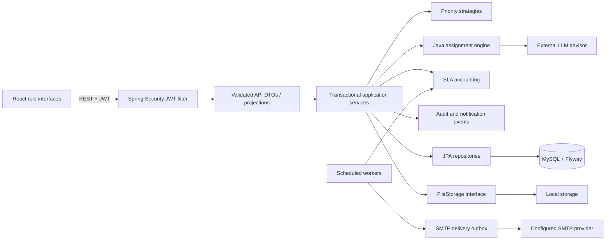
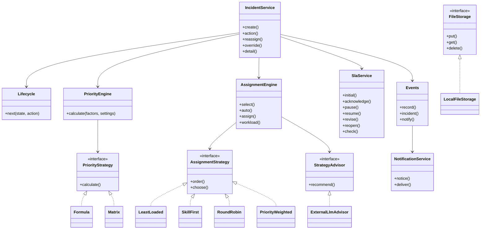
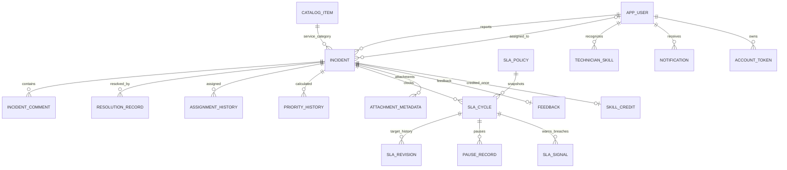
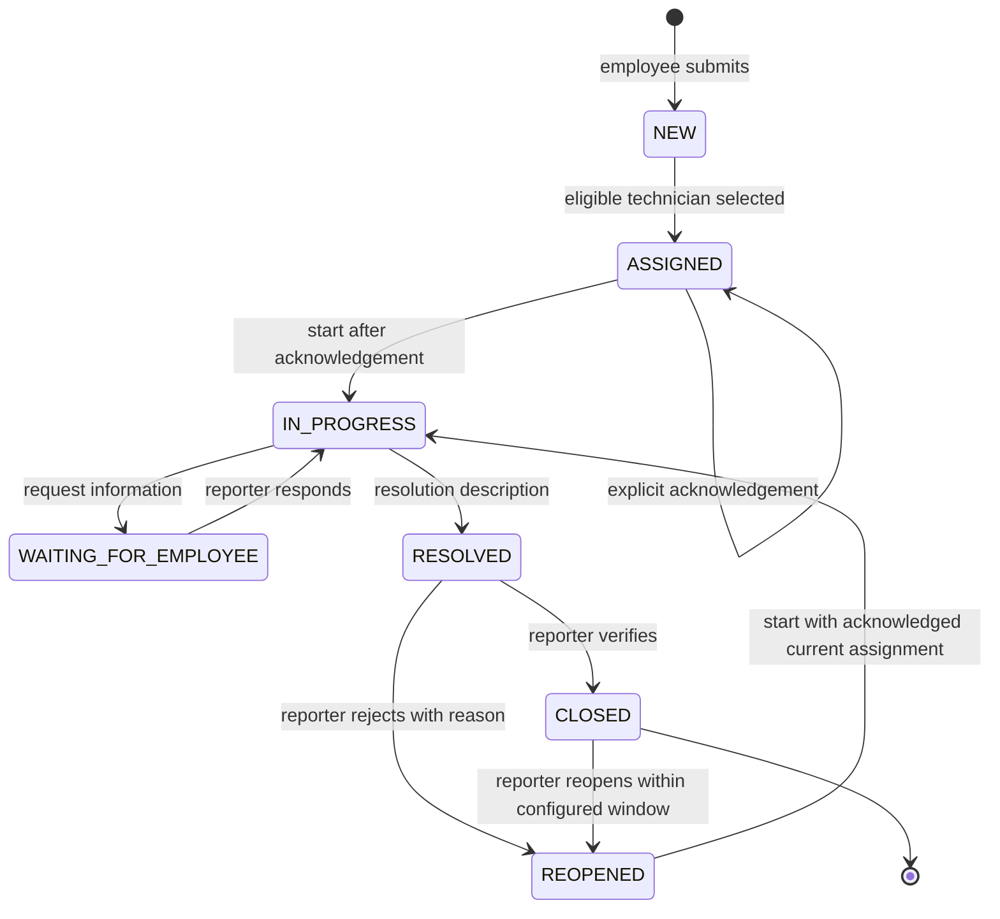
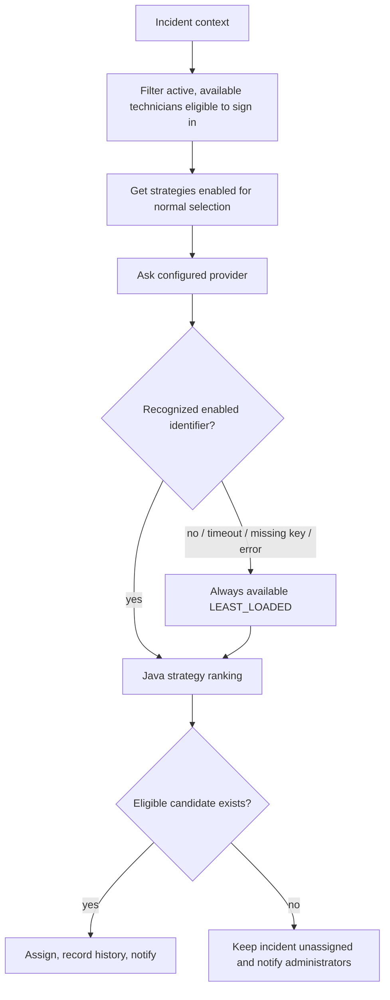
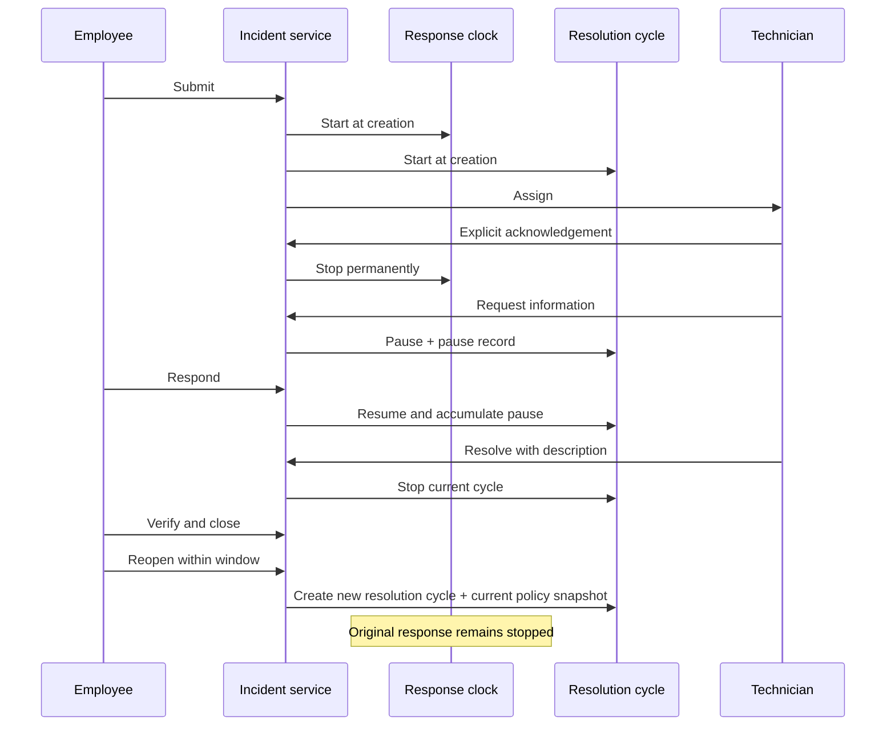

# Technical design

## Problem and objectives

Unstructured support requests lose ownership, make response commitments hard to measure, and provide little evidence for resolution quality. I-ITSM connects reporting, deterministic routing, technician work, employee verification, historical SLA accounting and management reporting in one transactional application.

Functional requirements cover three roles, private incident ownership, the complete seven-state lifecycle, feedback, attachments, configurable priority/assignment policies, recognized skills, independent response/resolution clocks, audit events, notifications, search and reports. Non-functional requirements include predictable routing, backend authorization, atomic state changes, UTC-safe timestamps, immutable history, repeatable migrations, responsive UI, and provider-independent availability.

## Technology and alternatives

Java 25 and Spring Boot 4.1.2 provide the mandatory Java platform, dependency injection, transactions and web/security infrastructure. Spring Data JPA/Hibernate maps persistence; a generic EntityManager repository handles history queries while a Spring Data `UserRepository` handles identity lookup. MySQL stores all durable application data, with Flyway V1 schema, V2 constraints and indexes, and V3 administrator-created accounts. React uses Vite and JavaScript; CSS supplies the design system, Recharts renders database-backed reports. springdoc 3.2.0 provides Boot 4-compatible OpenAPI.

Boot 4's Java 25 support is documented by [Spring](https://spring.io/blog/2025/11/20/spring-boot-4-0-0-available-now/); [springdoc](https://springdoc.org/) documents its 3.x / Boot 4 compatibility. Dependency resolution, compilation, packaging and MySQL integration were also executed, rather than inferred from these compatibility claims.

A modular monolith avoids distributed transactions and unnecessary infrastructure. Microservices, a message broker and vector search were deliberately not introduced. A SQL database fits the relations and historical constraints better than document-only storage. Dynamic workload counts were chosen over cached counters. A real LLM strategy advisor was chosen over arbitrary AI technician selection. Local file storage is replaceable through an interface. H2 is test-only; it is not a substitute for the separately executed MySQL tests.

## Architecture and module responsibilities

| Module | Responsibility |
|---|---|
| auth / user | BCrypt authentication, JWT validation, token version, email verification/recovery, identity repository, access guards |
| incident | Lifecycle policy, creation, comments/notes, resolution, verification, rejection and reopening orchestration |
| category / config | Typed service/category catalog, administrator operations, versioned central settings, optional development seed |
| priority | Formula/matrix strategies and append-only priority factors/history |
| assignment | Four independent comparators, strategy factory, AI abstraction, deterministic fallback and assignment history |
| technician | Deduplicated verified incident credits and skill recognition history |
| sla | Policy snapshots in cycles, revisions, pause records, idempotent warning/breach events and scheduler |
| audit / notification | Append-only audit and synchronous transactional notice events; separate durable SMTP delivery |
| attachment / feedback | Validated local bytes, protected metadata/downloads, closure-only one-time feedback |
| search / report | Parameterized scoped filters, bounded pagination, real-data aggregates and technician/SLA views |
| common | Repository abstraction, explicit DTO projections, application exceptions, consistent error mapping |

Service and category records share a typed catalog table. Investigation notes share the comments table with an internal flag and server-side exclusion for employees. Each SLA cycle contains its own original snapshot; target revisions are separate rows. A recognized-skill row contains immutable recognition timestamp and threshold, supplemented by the audit trail.

## Roles and use cases

```mermaid
flowchart TB
 E[Employee] --> Register[Register / verify / recover account]
 E --> Report[Report and view own incidents]
 E --> Respond[Provide requested information]
 E --> Verify[Verify or reject resolution]
 E --> Feedback[Feedback / reopen within window]
 T[Technician] --> Assigned[View assigned incidents]
 T --> Ack[Acknowledge assignment]
 T --> Investigate[Investigate / request information / resolve]
 T --> Skills[View workload and recognized skills]
 A[Administrator] --> All[View all incidents / reassign / override priority]
 A --> Configure[Users / catalog / priority / assignment / SLA configuration]
 A --> Monitor[Audit / delivery / SLA monitoring / reports]
 E --> Notify[Private notification history]
 T --> Notify
 A --> Notify
```

The backend authorizes every object request. Employees access their own incidents; technicians access only currently assigned incidents; administrators can access all. Only the assigned technician acknowledges, investigates or resolves. Only the reporter responds, verifies, rejects, reopens or gives feedback. Administrators reassign and override priority but cannot impersonate employee verification. Internal notes never appear in an employee detail response. Role/account changes increment the JWT token version; the filter loads current account state on every request.

## Class diagram and OOP

Abstraction is expressed through priority/assignment/provider/storage interfaces. Polymorphism selects real independent implementations. Composition injects collaborators into services. Service methods encapsulate domain changes; persistence records are not serialized directly and do not serve as request objects. Interface implementation provides useful type inheritance without an artificial entity hierarchy. Exceptions distinguish missing records, invalid transitions and access denial.

Strategy is used for priority and routing, with an explicit implementation registry as a factory. `Lifecycle` is a centralized table-driven State equivalent. Spring events implement Observer-style notification generation. Repositories abstract JPA access. Dependency injection wires collaborators and substitutes external providers in tests. Large orchestration concerns are separated across incident, assignment, SLA, skill and notification services.

## Data model and relationships

Migration SQL is the schema authority. Foreign keys relate typed catalog, users, incidents, policies and cycles. Unique constraints protect user email, incident reference, token hashes, catalog names within type, feedback per incident, skill credit per incident, recognized technician/category skill, and cycle/threshold warnings. Search, assignment, foreign-key, cycle, audit and notification indexes support frequent access. No application operation deletes incident, resolution, policy, SLA or audit history. Attachment deletion is logical; bytes are retained until an external retention process is introduced.

`audit_log` has an entity type/id association because it spans multiple aggregate types. `settings` is a single versioned configuration and a pessimistic serialization lock. Settings changes record complete before/after configuration in the audit log. Policies create new versions and deactivate previous selection candidates; original cycle values remain untouched. Roles are a constrained enum-like string because there are exactly three primary roles, rather than an unnecessary many-to-many role table.

## Incident lifecycle

Acknowledgement is not acceptance and does not alter workload. It is recorded on the current assignment history row. A newly reassigned technician must acknowledge before starting or resolving. Reassignment preserves the workflow state; already stopped response clocks remain stopped. NEW incidents remain visible and alert administrators if no technician is eligible. Rejected resolutions create a new resolution cycle immediately; rejected attempts never receive skill credit. The 90-day window applies to reopening CLOSED incidents, measured from their latest verified closure. Re-verification updates closure time. This interpretation is documented rather than silently resetting earlier cycles.

## Priority calculation

Factors are constrained to 1..3 for impact, urgency and criticality, with positive affected users. Affected-users tier is 1 below 10, 2 from 10 to 99, and 3 from 100 upward.

Formula default: `3*impact + 3*urgency + 2*criticality + 1*affectedTier`. Scores below 13 are LOW; 13..19 MEDIUM; 20..26 HIGH; 27+ CRITICAL. All weights and cutoffs are configurable.

Matrix default, impact rows and urgency columns:

| Impact / urgency | 1 | 2 | 3 |
|---|---|---|---|
| 1 | LOW | LOW | MEDIUM |
| 2 | LOW | MEDIUM | HIGH |
| 3 | MEDIUM | HIGH | CRITICAL |

Criticality 3 or at least 100 affected users raises the matrix result one level, capped at CRITICAL. The nine matrix cells are configurable. Every calculated/overridden priority records factors, configuration version, actor and reason. Overrides append SLA target revisions for running clocks; completed clocks remain historical.

## Assignment workflow and deterministic ranking

Eligibility always requires role TECHNICIAN, active account, sign-in eligibility and availability. No AI output can change this predicate. All comparisons end with ascending numeric technician ID, so identical inputs are deterministic.

| Strategy | Ordered selection |
|---|---|
| LEAST_LOADED | Active assigned workload ascending, recognized category skill preferred, technician ID |
| SKILL_FIRST | Recognized category skill preferred, workload ascending, technician ID |
| ROUND_ROBIN | Last assignment history ID ascending (never-assigned = 0), technician ID |
| PRIORITY_WEIGHTED | Minimize `workload * loadWeight - skilled * skillWeight * (priorityRank + 1)`, then technician ID |

Priority ranks are LOW=0, MEDIUM=1, HIGH=2, CRITICAL=3. Default loadWeight=10 and skillWeight=100. Administrators can configure weights and enabled strategy names. The AI receives category ID, priority and anonymized candidate IDs/skill/workload/recent-assignment values. The API call has a 3-second connection timeout and 5-second overall request timeout. Only validated enabled strategy output is accepted. Selection source, strategy and fallback reason are recorded in assignment history. An invalid candidate is never silently used.

Recognized skills are credited once per incident, to the technician who supplied the verified resolution, even if an administrator reassigns the resolved incident before verification. Repeated reopen/verify cycles cannot farm credits. Default recognition threshold is 60; administrators can change it. Recognition occurs at the next verified resolution that reaches the current threshold, preserving timestamp and threshold used.

## Workload and concurrency

Workload is a database-derived count of incidents currently assigned to a technician whose state is not RESOLVED or CLOSED. A new assignment adds one; acknowledgement, investigation and waiting do not change the count; resolution removes one; closure does not remove another; reopening adds one; active reassignment transfers one; resolved reassignment adds nothing until reopened. There is no stored workload counter to go negative or require reconciliation.

Mutating incident/assignment/SLA/configuration operations acquire the singleton settings row with a pessimistic write lock and, where appropriate, the incident row, inside a transaction. This intentionally serializes routing-sensitive writes across app instances. READ_COMMITTED isolation ensures workload selection sees the preceding committed assignment after obtaining the lock. Rollback covers state, assignment history, SLA records, audit and in-app notification inserts. Unique cycle/threshold constraints reinforce scheduler idempotence. This simple scheme favors correctness; lock contention at high volume is a documented scaling limitation.

## SLA accounting and historical accuracy

All event timestamps use Java `Instant`, serialize with UTC offsets, and persist to MySQL `DATETIME(6)` using explicit UTC JDBC configuration and timestamp mapping. No persisted `LocalDateTime` is used. The React UI displays local timezone times and identifies the timezone; daily trend buckets use UTC explicitly.

- Both initial clocks start at incident creation, before assignment or acknowledgement.
- The single original response cycle stops at the first explicit current-assignment acknowledgement. Waiting never pauses it. Reassignment and reopening never restart it.
- Resolution pauses only when entering WAITING_FOR_EMPLOYEE, records each pause interval, resumes on the reporter's response, and stops at resolution.
- Each reopen/reject starts a new resolution cycle with the currently active policy snapshot. Missing policy prevents that reopening transaction; original cycles remain unchanged.
- Original snapshot fields (policy identity/version, original priority/target and start) are non-updatable JPA columns. Target revisions are immutable appended entities containing old/new targets, priorities, policy/version, actor and timestamp.
- Priority changes affect only running clocks, using their original start and accrued pauses. Missing active policy preserves the existing target, appends a configuration-issue audit event and notifies administrators.

For an unpaused running resolution clock: `deadline = startedAt + currentTargetSeconds + accumulatedPauseSeconds`. While paused, the displayed projected deadline also adds the ongoing pause duration. Elapsed active time excludes complete and ongoing pauses. Response has no pauses. At a stop, elapsed and deadline become stable.

The scheduler evaluates every 15 seconds. Default warning thresholds are 50% and 80%, centrally configurable. Late checks emit any crossed threshold that has not already been recorded. Breach requires elapsed > target, not merely equality. Each signal stores its detected time and the actual applicable deadline separately. Uniqueness is per cycle and threshold, even across target revisions. Historical breaches remain after resolution and later deadline revisions. Compliance counts completed cycles with no historical breach divided by all completed cycles; running cycles are not included in that denominator. Average resolution time averages completed resolution-cycle active seconds, excluding employee pauses. Reports also expose service/snapshot-priority compliance and historical incident trends.

## Security, notifications and attachments

JWTs are HMAC-SHA256 signed with a required base64 secret of at least 32 random bytes, expire after one hour and are kept only in frontend memory. Current role, activation, verification and token version are checked on each request. Registration has no caller-controlled role/verification field. Email verification/recovery use random 256-bit values with SHA-256 hashes at rest, one-hour expiry and locked single-use consumption. Recovery invalidates prior sessions. Account emails contain token links only in the private delivery outbox; audit logs never contain raw tokens or password hashes. Delivered account-mail bodies are scrubbed.

Audit entries are immutable JPA records and have no update/delete endpoint. In-app notices are emitted synchronously inside the business transaction. SMTP work is performed later, records delivery outcome/failure and does not roll back the originating incident. Warnings/breaches notify the assigned technician and active administrators.

Uploads have a 5 MB limit and allow PDF, PNG, JPEG and text with extension/signature checks. Names are sanitized, bytes use random UUID storage keys, and paths never appear in response DTOs. Downloads recheck incident access and force attachment/octet-stream with `nosniff`. Metadata deletion is authorized for uploader or admin and hides downloads while retaining bytes for audit. Storage writes register rollback cleanup. Malware scanning and retention cleanup are future enhancements, not claimed as implemented.

## Frontend

The UI uses a quiet green/neutral service-workspace design, responsive sidebar, role navigation, cards, scoped tables, charts, status badges, confirmations, validated forms, loading/empty states and server-error messages. Incident detail connects all role actions and displays clock snapshots/revisions, assignment acknowledgement, resolution attempts, audit history, priority factors and attachments. Authentication tokens remain in memory; reload intentionally signs out. The production build is packaged into the Spring Boot JAR for same-origin delivery.
